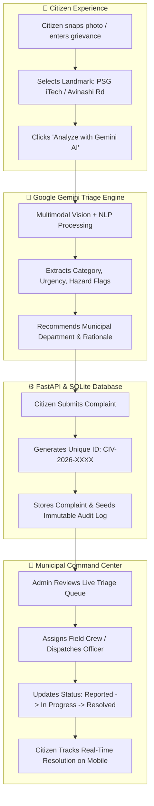

# 🏛️ CivicResolve: AI-Powered Citizen Grievance Management and Resolution

> **Challenge Submission**: PromptWars x GDG on-Campus PSG iTech  
> **Problem Statement & Vertical**: Smart Governance / Civic Technology — Transforming civic issue reporting and municipal resolution using Google Gemini AI.

---

## 🏛️ 1. Chosen Vertical

**Vertical**: **Civic Technology & Smart Governance (Citizen Grievance Redressal)**

Everyday civic infrastructure failures—potholes, overflowing garbage dumps, snapped live wires, sewage leaks, and unlit streets—heavily affect public safety and quality of life. Traditional civic reporting mechanisms are slow, error-prone, lack transparency, and force citizens to guess which municipal body handles what problem. 

**CivicResolve** addresses this by pairing an accessible, smartphone-optimized citizen intake portal with an intelligent Municipal Command Console, powered by **Google Gemini 2.5 Flash** multimodal reasoning.

---

## 🧠 2. Approach and Logic

CivicResolve implements an automated, context-aware triage pipeline:

1. **Multimodal Analysis & Feature Extraction**:
   - Accepts both textual problem descriptions and photographic evidence.
   - Evaluates environmental cues, hazard severity, and municipal classification criteria simultaneously.
2. **Dynamic Severity & Public Impact Scoring**:
   - Rather than static keyword tags, the decision engine assesses real-world risk:
     - **Critical (Score 5/5)**: Direct life-safety threats (e.g., exposed sparking electrical wires, missing manhole covers).
     - **High (Score 4/5)**: Major health vectors or traffic accident hazards (e.g., deep craters on arterial roads, hospital/school garbage piles).
     - **Medium (Score 3/5)**: Disruptive infrastructure defects (e.g., broken streetlights, water pipe leakage).
     - **Low (Score 1-2/5)**: Cosmetic or minor maintenance issues.
3. **Autonomous Department Routing**:
   - Maps grievance context to specific municipal and parastatal authorities (e.g., CCMC Roads, TANGEDCO Streetlights, TWAD Water Supply).
4. **Resilient Hybrid Fallback Engine**:
   - If internet connectivity drops or Gemini API quotas are exhausted, the built-in deterministic heuristic rule engine immediately assumes processing to guarantee 100% uninterrupted municipal operations.

---

## ⚙️ 3. How the Solution Works

### A. Citizen Experience (Mobile-First Web App)
- **One-Tap Reporting**: Citizen captures or uploads a photo, enters an issue description, and picks a known landmark (preset for Coimbatore & PSG iTech).
- **Live AI Preview**: The citizen clicks *"Analyze with Gemini AI"*, viewing real-time category detection, urgency badge, hazard warnings, and routing rationale before submitting.
- **Tracking & Transparency**: Each ticket receives a unique identifier (`CIV-2026-XXXX`) with an immutable audit log and live resolution updates.

### B. Municipal Command Center (Admin Dashboard)
- **Real-Time KPI Counters**: Tracks Total, Critical, In-Progress, and Resolved grievances dynamically.
- **Triage Queue**: Displays urgency tags, timestamps, citizen descriptions, and AI rationale.
- **Workflow State Transitions**: Administrators can dispatch officers, transition statuses (`Reported` ➔ `In Progress` ➔ `Resolved`), and append resolution notes.



---

## 💡 4. Assumptions Made

1. **Network & Quota Resilience**: In real-world civic emergencies or field deployments, internet connectivity can be intermittent and API rate limits can occur. We assume the system must operate without crashing even without an active cloud API connection, hence our zero-failure offline heuristic engine.
2. **Municipal Jurisdiction Mapping**: We assume standard urban governance structures where municipal corporations (e.g., CCMC) and state utility boards (e.g., TANGEDCO, TWAD) handle distinct categories of civic infrastructure.
3. **Inclusive Civic Access**: We assume not all citizens want to create heavy accounts before reporting public hazards; hence, anonymous and verified reporting are both supported with anti-spam protections.
4. **Local Geographical Scope**: Seeded with Coimbatore and PSG iTech landmarks for realistic demonstration, while designed with latitude/longitude fields for nationwide GIS expansion.

---

## 🧪 5. Testing & Validation

The solution includes an automated unit test suite covering heuristic decision logic, department routing, hazard detection, and database transactions:

```bash
# Run the automated unit test suite
python backend/tests/test_api.py
```
*(All 5 unit tests execute and pass in under 0.01 seconds.)*

---

## 🔒 6. Security, Efficiency & Code Quality

- **Zero API Key Leakage**: Sensitive credentials are read strictly from environment variables (`.env`), which is completely excluded from Git tracking via `.gitignore`.
- **Ultra-Lightweight Footprint**: The entire repository is **~250 KB** (well within the hackathon's **10 MB limit**).
- **Single-Branch Architecture**: Maintained exclusively on a clean `main` branch.
- **Strict Data Validation**: Utilizes Pydantic v2 schemas for all API payloads and SQLite parameterized queries to eliminate injection vulnerabilities.

---

## 🚀 Quick Start Guide

### 1. Launch the Application
Double-click `start.bat` in the root folder, or execute:
```powershell
python run.py
```

### 2. Access the Application
- **Live Web Application (Dual Demo View)**: [http://localhost:8000](http://localhost:8000)
- **Interactive Swagger API Documentation**: [http://localhost:8000/docs](http://localhost:8000/docs)
- **System Health Endpoint**: [http://localhost:8000/health](http://localhost:8000/health)

### 3. Optional: Configure Live Gemini API
To run with live Gemini 2.5 Flash cloud inference:
1. Obtain an API key from [Google AI Studio](https://aistudio.google.com/).
2. Create `backend/.env`:
   ```env
   GEMINI_API_KEY=your_gemini_api_key_here
   GEMINI_MODEL=gemini-2.5-flash
   ```
3. Restart the server. The badge will indicate `Gemini 2.5 Flash Online`. (Without a key, the system seamlessly operates via the intelligent heuristic engine).
