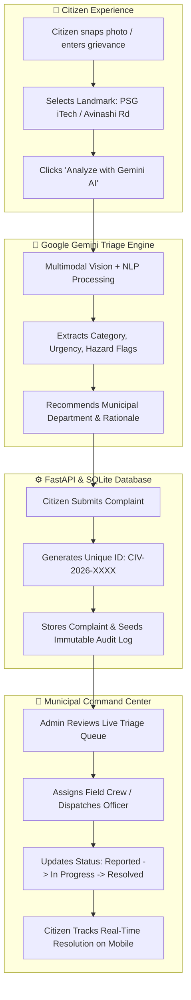

# 🏛️ CivicResolve: AI-Powered Citizen Grievance Management and Resolution

> **Hackathon Submission**: PromptWars x GDG on-Campus PSG iTech  
> **Problem Statement**: CivicResolve — Transforming civic issue reporting and municipal resolution using Google Gemini AI.

---

## 📌 Executive Summary
Everyday civic issues such as potholes, overflowing garbage bins, damaged streetlights, water leakage, and poor road conditions significantly affect communities. However, reporting these issues and ensuring they reach the appropriate municipal authorities is often complicated, slow, and disconnected.

**CivicResolve** bridges this gap:
1. **For Citizens**: An intuitive smartphone-first interface that enables reporting complaints in seconds with photo evidence, landmark auto-detection, and live Google Gemini AI triage preview.
2. **For Municipal Authorities**: A real-time Municipal Command Console that visualizes incoming grievances, auto-categorizes issues, detects urgency/public safety hazards, routes tickets to the correct municipal department, and tracks resolution SLAs with immutable audit logs.

---

## 🌟 Expected Features & Implementation Matrix

| Requirement | Implementation in CivicResolve | Tech / Model |
| :--- | :--- | :--- |
| **Citizen Issue Reporting** | Title, description, photo upload/camera preview, location selection with preset Coimbatore / PSG iTech landmarks, anonymous or verified reporting. | React 18, Tailwind CSS, Base64 & Multipart File Storage |
| **AI-Powered Classification** | Classifies into 7 civic categories: Potholes & Road Damage, Garbage & Sanitation, Streetlights & Electrical, Water Leakage, Drainage, Public Infrastructure, and Other. | **Google Gemini 2.5 Flash** (via `google-genai` SDK) |
| **Priority & Urgency Detection** | Detects Urgency (`Critical`, `High`, `Medium`, `Low`) and Public Impact Score (1 to 5) by evaluating life-safety hazards (live wires, traffic swerving, disease vectors). | Gemini Multimodal & Heuristic Safety Reasoner |
| **Department Recommendation** | Automatically routes complaints to the appropriate authority (CCMC Roads, TANGEDCO Streetlights, TWAD Water Supply, CCMC Sanitation, Stormwater Drainage). | Automated AI Municipal Routing Matrix |
| **Issue Tracking Dashboard** | Real-time status badges (`Reported`, `In Progress`, `Resolved`), filterable list, public feed, and detailed complaint modals. | Fast SQLite Queries & Reactive State Sync |
| **Admin Dashboard** | Municipal Command Center with KPI stat counters (Total, Critical, Pending, Resolved), live search, one-click status transitions, officer dispatch, and resolution notes. | Unified Dual-Mode Console with Audit Logging |
| **Zero-Failure Demo Engine** | Built-in offline Heuristic AI fallback mode so your hackathon presentation never crashes even if API keys expire or WiFi disconnects. | Resilient Hybrid AI Pipeline |

---

## 🏗️ Architecture & Workflow



---

## 🚀 Quick Start Guide (Windows)

### 1. One-Click Launch
Double-click `start.bat` in the root folder, or run:
```powershell
py -3 run.py
```
*(Or run with direct Python: `C:\Users\Admin\AppData\Local\Programs\Python\Python313\python.exe run.py`)*

### 2. Open in Your Browser
- **Live Web Application (Dual Demo View)**: [http://localhost:8000](http://localhost:8000)
- **Interactive Swagger API Documentation**: [http://localhost:8000/docs](http://localhost:8000/docs)
- **API Health Endpoint**: [http://localhost:8000/health](http://localhost:8000/health)

---

## 🔑 Configuring Your Google Gemini API Key
CivicResolve is built to run immediately in **Heuristic AI Mode** right out of the box with 5 pre-seeded realistic grievances around Coimbatore and PSG iTech.

To enable live inference with **Gemini 2.5 Flash**:
1. Get a free API key from [Google AI Studio](https://aistudio.google.com/).
2. Create or edit `backend/.env`:
   ```env
   GEMINI_API_KEY=your_actual_gemini_api_key_here
   GEMINI_MODEL=gemini-2.5-flash
   ```
3. Restart the server. The top status badge will immediately turn green: `Gemini 2.5 Flash Online`!

---

## 📁 Repository Structure

```
CivicResolve/
├── backend/
│   ├── app/
│   │   ├── main.py              # FastAPI application, CORS, static serving & lifespan
│   │   ├── database.py          # SQLite connection, thread-safe queries & audit log helpers
│   │   ├── schemas.py           # Pydantic v2 validation models
│   │   ├── ai_service.py        # Gemini multimodal integration & heuristic fallback
│   │   ├── seed_data.py         # 5 pre-seeded realistic Coimbatore/PSG iTech grievances
│   │   └── routes/
│   │       ├── complaints.py    # GET /api/complaints, POST /api/complaints, status updates
│   │       ├── ai_triage.py     # POST /api/ai/preview (live interactive AI triage)
│   │       └── stats.py         # GET /api/stats (KPI metrics & distributions)
│   ├── uploads/                 # Local storage for citizen uploaded grievance photos
│   └── run.py                   # Backend entrypoint
├── frontend/                    # Vite + React + TypeScript + Tailwind source code
│   ├── package.json
│   ├── vite.config.ts
│   └── src/
│       ├── types.ts             # TypeScript interfaces for complaints & audit logs
│       └── ...
├── static/
│   └── index.html               # Complete, standalone React 18 + Tailwind SPA (Dual Demo View)
├── run.py                       # Root launcher script
├── start.bat                    # One-click Windows launch batch file
└── README.md                    # Comprehensive documentation
```

---

## 🎯 Hackathon Presentation & Demo Script (For Judges)

When presenting CivicResolve to the PromptWars judges:

1. **Show the Dual Demo Mode**:
   - Point out the **Simulated Mobile Citizen App** on the left and the **Municipal Command Center** on the right.
   - Explain how citizens report grievances easily on their phones while municipal administrators monitor issues on a unified GIS-ready dashboard.

2. **Demonstrate AI-Powered Issue Reporting**:
   - In the Citizen app, click one of the quick test presets (e.g., `⚡ Live Wire at Bypass` or `⚠️ Avinashi Rd Pothole`).
   - Click the glowing **"Analyze with Gemini AI"** button.
   - Show how Gemini automatically detects:
     - **Category**: *Streetlights & Electrical*
     - **Urgency**: *Critical (5/5 Public Impact)*
     - **Recommended Department**: *TANGEDCO - Streetlights*
     - **Hazard Flags**: *Electrocution Risk, Public Safety Emergency*
     - **AI Reasoning**: Explains *why* it's critical.

3. **Show Live Submission & Real-Time Sync**:
   - Click **"Submit Grievance"**.
   - Watch the new grievance immediately appear in the **Admin Command Console** on the right!
   - Highlight the KPI counter updating instantly.

4. **Demonstrate Administrative Triage & Resolution Workflow**:
   - In the Admin console, change the status dropdown from **"Reported"** to **"In Progress"**.
   - Click **"Inspect 🔍"** to show the **Immutable Audit History**, showing when the citizen lodged the ticket, when Gemini AI performed the triage, and which municipal officer was assigned.
   - Update to **"Resolved"** with resolution notes to demonstrate the end-to-end lifecycle.

5. **Mention Resilient Architecture**:
   - Highlight the hybrid architecture: If the network drops or API quotas are reached, CivicResolve's built-in intelligent heuristic engine takes over smoothly, ensuring zero downtime during real-world civic emergencies.
